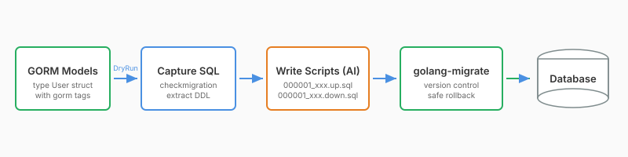
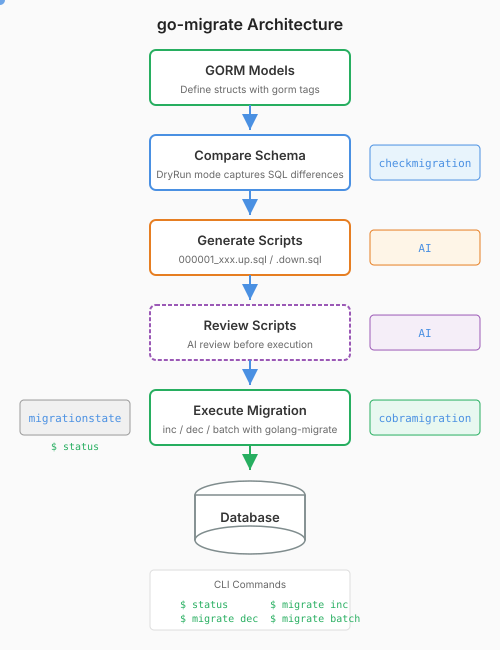

<!-- TEMPLATE (EN) BEGIN: BADGES -->

[](https://github.com/yylego/go-migrate/actions/workflows/release.yml?query=branch%3Amain)
[](https://pkg.go.dev/github.com/yylego/go-migrate)
[](https://coveralls.io/github/yylego/go-migrate?branch=main)
[](https://go.dev/)
[](https://github.com/yylego/go-migrate/releases)
[](https://goreportcard.com/report/github.com/yylego/go-migrate)

<!-- TEMPLATE (EN) CLOSE: BADGES -->

# go-migrate

Database migration toolkit with GORM schema analysis, migration execution and status management.

---

## Ecosystem





<!-- TEMPLATE (EN) BEGIN: LANGUAGE NAVIGATION -->

## CHINESE README

[中文说明](README.zh.md)

<!-- TEMPLATE (EN) CLOSE: LANGUAGE NAVIGATION -->

## Features

- **Smart Schema Analysis**: Auto-compare GORM models with existing database schemas
- **Multi-Database Support**: Works with MySQL, PostgreSQL, SQLite through golang-migrate
- **Comprehensive CLI**: Intuitive Cobra commands with complete migration support
- **Status Inspection**: Check database version, pending migrations and schema differences

## Core Packages

| Package          | Purpose                                                                                 |
| ---------------- | --------------------------------------------------------------------------------------- |
| `checkmigration` | Compare GORM models with database, capture SQL differences                              |
| `newmigrate`     | Thin pass-through to the golang-migrate constructors; calling them as-is works the same |
| `migrationparam` | Migration connection management and debug mode settings                                 |
| `cobramigration` | Cobra CLI commands (inc/dec/batch)                                                      |
| `migrationstate` | Check migration status                                                                  |

## Schema probe errors

`checkmigration.CheckMigrate(db, objects)` returns `([]string, error)`; `GetMigrateOps` returns `(MigrationOps, error)`. Failed probes return no incomplete results, and the code that calls them handles the `error`. To panic on failure, use `must.Done(err)`:

```go
sqls, err := checkmigration.CheckMigrate(db, objects)
must.Done(err)
```

These APIs capture SQL through GORM DryRun and read schema metadata. PostgreSQL column metadata uses a separate session with DryRun off; DDL stays in DryRun and the supplied configuration remains intact. Failed reads produce errors instead of missing-table results. Scope follows GORM AutoMigrate, not a complete schema diff; a failed probe does not mean the schema matches.

On PostgreSQL:

- A changed column comment gives `COMMENT ON COLUMN`. On a column outside the `PRIMARY KEY`, GORM itself adds an `ALTER TABLE ... ALTER COLUMN ... TYPE` statement with the unchanged type, so one changed comment shows up as two statements.
- A column that turns auto-increment gives the sequence statements.
- A column that stops being auto-increment cannot be probed: the probe returns a `dry run mode unsupported` error, so write the migration script without the probe.

On SQLite, a changed column type cannot be probed: the SQLite dialect panics in DryRun, and the probe returns that as an error.

## Installation

```bash
go get github.com/yylego/go-migrate
```

## Quick Start

### 1. Define GORM Models

```go
type Account struct {
    ID   uint   `gorm:"primarykey"`
    Name string `gorm:"size:100"`
    Age  int
}
```

### 2. Setup CLI Program

```go
package main

import (
    "github.com/yylego/go-migrate/cobramigration"
    "github.com/yylego/go-migrate/migrationparam"
    "github.com/yylego/go-migrate/migrationstate"
    "github.com/yylego/go-migrate/newmigrate"
    "github.com/golang-migrate/migrate/v4"
    mysqlmigrate "github.com/golang-migrate/migrate/v4/database/mysql"
    "github.com/spf13/cobra"
    "github.com/yylego/must"
    "github.com/yylego/rese"
    "gorm.io/gorm"
)

func main() {
    scriptsPath := "./scripts"

    // MigrationParam with on-demand initialization and unified resource management
    param := migrationparam.NewMigrationParam(
        func() *gorm.DB {
            return setupDatabase() // GORM setup goes here
        },
        func(db *gorm.DB) *migrate.Migrate {
            conn := rese.P1(db.DB())
            migrationDB := rese.V1(mysqlmigrate.WithInstance(conn, &mysqlmigrate.Config{}))
            return rese.P1(newmigrate.NewWithScriptsAndDatabase(&newmigrate.ScriptsAndDatabaseParam{
                ScriptsInRoot:    scriptsPath,
                DatabaseName:     "mysql",
                DatabaseInstance: migrationDB,
            }))
        },
    )

    objects := []any{
        &Account{},
    }

    rootCmd := &cobra.Command{Use: "app"}
    rootCmd.AddCommand(cobramigration.NewMigrateCmd(param))
    rootCmd.AddCommand(migrationstate.NewStatusCmd(&migrationstate.Config{
        Param:       param,
        ScriptsPath: scriptsPath,
        Objects:     objects,
    }))

    must.Done(rootCmd.Execute())
}
```

### 3. Common Workflow

```bash
# Step 1: Check current status
go run main.go status

# Step 2: Write migration scripts (hand-written / AI-generated)
# e.g., scripts/000001_xxx.up.sql and scripts/000001_xxx.down.sql

# Step 3: Execute migration
go run main.go migrate inc    # One step
go run main.go migrate batch  # batch run
```

## Design Intent

Migration scripts are hand-written, and an AI assistant can write them too: it reads the GORM struct changes and writes the SQL, with no database needed, and the scripts keep one consistent style.

go-migrate does the parts that the scripts do not handle: **checking that the models match the database, running the migrations, and reporting the status**.

## CLI Command List

| Command         | Description                                            |
| --------------- | ------------------------------------------------------ |
| `status`        | Show database version, pending migrations, schema diff |
| `migrate`       | Show current migration version                         |
| `migrate inc`   | Execute next migration                                 |
| `migrate dec`   | Rollback one migration                                 |
| `migrate batch` | Execute pending migrations at once                     |

`status` says "up to date" when no script is pending and the last migration finished. When the last migration did not finish (golang-migrate calls this dirty), the version shows `(DIRTY)` and `Status.IsUpToDate` is false. With no models given, the schema is not compared, and the output says "not checked".

`migrate batch`, `migrate inc` and `migrate dec` print a warning when golang-migrate reports a missing script (`os.ErrNotExist`). It comes from one of two cases: `inc` / `dec` have no step left in that direction; the scripts path is wrong.

## Database Support

Works with MySQL, PostgreSQL, SQLite through golang-migrate drivers:

```go
// MySQL
import mysqlmigrate "github.com/golang-migrate/migrate/v4/database/mysql"
migrationDB := rese.V1(mysqlmigrate.WithInstance(conn, &mysqlmigrate.Config{}))

// PostgreSQL
import postgresmigrate "github.com/golang-migrate/migrate/v4/database/postgres"
migrationDB := rese.V1(postgresmigrate.WithInstance(conn, &postgresmigrate.Config{}))

// SQLite
import sqlite3migrate "github.com/golang-migrate/migrate/v4/database/sqlite3"
migrationDB := rese.V1(sqlite3migrate.WithInstance(conn, &sqlite3migrate.Config{}))
```

## Advanced Configuration

### Debug Mode

The default `status` output contains results and schema differences without probe SQL. Enable debug mode to inspect SQL traces; SQL capture and fault checks remain active in both modes. The demo commands accept `status --debug`:

```go
import "github.com/yylego/go-migrate/migrationparam"

// Enable debug mode to see migration details
migrationparam.SetDebugMode(true)

// Check current debug mode status
if migrationparam.DebugMode() {
    // Debug logging is enabled
}
```

### Embedded Migrations

```go
//go:embed migrations
var migrationsFS embed.FS

migration := rese.P1(newmigrate.NewWithEmbedFsAndDatabase(&newmigrate.EmbedFsAndDatabaseParam{
    MigrationsFS:     &migrationsFS,
    EmbedPath:        "migrations",
    DatabaseName:     "mysql",
    DatabaseInstance: migrationDB,
}))
```

`MigrationsFS` takes a `fs.FS`; an `embed.FS` ships the scripts inside the built program.

## Examples

See [internal/demos/](internal/demos) with complete working examples:

- [demo1x](internal/demos/demo1x): MySQL integration with Makefile commands
- [demo2x](internal/demos/demo2x): PostgreSQL integration with Makefile commands

```bash
cd internal/demos/demo1x
make STATUS       # Check status
make MIGRATE-INC  # Execute next
make MIGRATE-ALL  # batch run
```

<!-- TEMPLATE (EN) BEGIN: STANDARD PROJECT FOOTER -->
<!-- VERSION 2025-11-25 03:52:28.131064 +0000 UTC -->

## 📄 License

MIT License - see [LICENSE](LICENSE).

---

## 💬 Contact & Feedback

Contributions are welcome! Report bugs, suggest features, and contribute code:

- 🐛 **Mistake reports?** Open an issue on GitHub with reproduction steps
- 💡 **Fresh ideas?** Create an issue to discuss
- 📖 **Documentation confusing?** Report it so we can improve
- 🚀 **Need new features?** Share the use cases to help us understand requirements
- ⚡ **Performance issue?** Help us optimize through reporting slow operations
- 🔧 **Configuration problem?** Ask questions about complex setups
- 📢 **Follow project progress?** Watch the repo to get new releases and features
- 🌟 **Success stories?** Share how this package improved the workflow
- 💬 **Feedback?** We welcome suggestions and comments

---

## 🔧 Development

New code contributions, follow this process:

1. **Fork**: Fork the repo on GitHub (using the webpage UI).
2. **Clone**: Clone the forked project (`git clone https://github.com/yourname/repo-name.git`).
3. **Navigate**: Navigate to the cloned project (`cd repo-name`)
4. **Branch**: Create a feature branch (`git checkout -b feature/xxx`).
5. **Code**: Implement the changes with comprehensive tests
6. **Testing**: (Golang project) Ensure tests pass (`go test ./...`) and follow Go code style conventions
7. **Documentation**: Update documentation to support client-facing changes
8. **Stage**: Stage changes (`git add .`)
9. **Commit**: Commit changes (`git commit -m "Add feature xxx"`) ensuring backward compatible code
10. **Push**: Push to the branch (`git push origin feature/xxx`).
11. **PR**: Open a merge request on GitHub (on the GitHub webpage) with detailed description.

Please ensure tests pass and include relevant documentation updates.

---

## 🌟 Support

Welcome to contribute to this project via submitting merge requests and reporting issues.

**Project Support:**

- ⭐ **Give GitHub stars** if this project helps you
- 🤝 **Share with teammates** and (golang) programming friends
- 📝 **Write tech blogs** about development tools and workflows - we provide content writing support
- 🌟 **Join the ecosystem** - committed to supporting open source and the (golang) development scene

**Have Fun Coding with this package!** 🎉🎉🎉

<!-- TEMPLATE (EN) CLOSE: STANDARD PROJECT FOOTER -->
