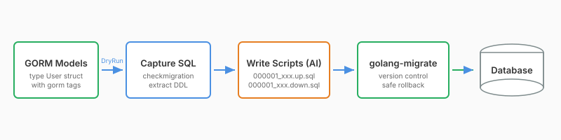
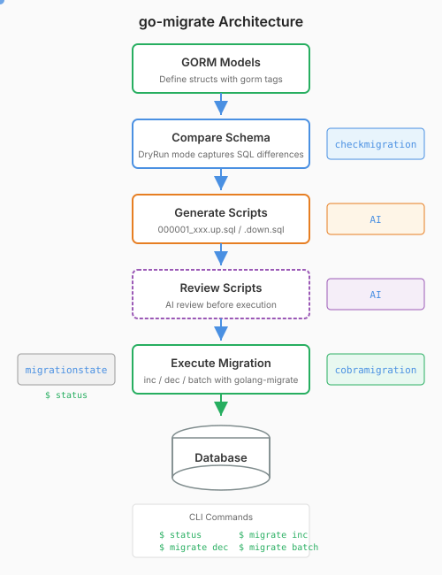

<!-- TEMPLATE (ZH) BEGIN: BADGES -->

[](https://github.com/yylego/go-migrate/actions/workflows/release.yml?query=branch%3Amain)
[](https://pkg.go.dev/github.com/yylego/go-migrate)
[](https://coveralls.io/github/yylego/go-migrate?branch=main)
[](https://go.dev/)
[](https://github.com/yylego/go-migrate/releases)
[](https://goreportcard.com/report/github.com/yylego/go-migrate)

<!-- TEMPLATE (ZH) CLOSE: BADGES -->

# go-migrate

数据库迁移工具包，集成 GORM 模型分析、迁移执行和状态管理功能。

---

## 生态系统





<!-- TEMPLATE (ZH) BEGIN: LANGUAGE NAVIGATION -->

## 英文文档

[ENGLISH README](README.md)

<!-- TEMPLATE (ZH) CLOSE: LANGUAGE NAVIGATION -->

## 核心特性

- **智能结构分析**：自动对比 GORM 模型与现有数据库结构
- **多数据库支持**：通过 golang-migrate 支持 MySQL、PostgreSQL、SQLite
- **全面 CLI 支持**：直观的 Cobra 命令覆盖所有迁移操作
- **状态检查功能**：检查数据库版本、待处理迁移和结构差异

## 核心包

| 包名             | 用途                                                  |
| ---------------- | ----------------------------------------------------- |
| `checkmigration` | 对比 GORM 模型与数据库，捕获 SQL 差异                 |
| `newmigrate`     | golang-migrate 构造函数的薄封装，直接调官方函数也一样 |
| `migrationparam` | 迁移连接管理和调试模式控制                            |
| `cobramigration` | Cobra CLI 命令 (inc/dec/batch)                        |
| `migrationstate` | 检查迁移状态                                          |

## 结构探测的错误处理

`checkmigration.CheckMigrate(db, objects)` 返回 `([]string, error)`，`GetMigrateOps` 返回 `(MigrationOps, error)`。探测失败不返回不完整结果，由调用方处理错误；需要失败即 panic 的调用方可显式使用 `must.Done(err)`：

```go
sqls, err := checkmigration.CheckMigrate(db, objects)
must.Done(err)
```

这些接口通过 GORM DryRun 捕获 SQL，仍会读取数据库结构。PostgreSQL 的列信息查询使用独立的非 DryRun 会话，DDL 继续预演，不改变调用方配置。查询失败会返回错误，不会被当成“表不存在”。探测范围取决于 GORM AutoMigrate，不能代替完整的 schema diff，探测失败也不代表结构一致。

在 PostgreSQL 上：

- 列注释有变化时结果里带 `COMMENT ON COLUMN`。非主键列还会多出一条类型没变的 `ALTER TABLE ... ALTER COLUMN ... TYPE`，这条是 GORM 自己带出来的，所以改一处注释会看到两条语句。
- 列改成自增时带建序列的语句。
- 列取消自增探测不出来：探测返回 `dry run mode unsupported` 错误，这种改动需要自己写迁移脚本。

在 SQLite 上，改列类型探测不出来：SQLite 方言在 DryRun 下会 panic，探测把它接成错误返回。

## 安装

```bash
go get github.com/yylego/go-migrate
```

## 快速开始

### 1. 定义 GORM 模型

```go
type Account struct {
    ID   uint   `gorm:"primarykey"`
    Name string `gorm:"size:100"`
    Age  int
}
```

### 2. 配置 CLI 工具

```go
package main

import (
    "github.com/yylego/go-migrate/cobramigration"
    "github.com/yylego/go-migrate/migrationparam"
    "github.com/yylego/go-migrate/migrationstate"
    "github.com/yylego/go-migrate/newmigrate"
    "github.com/golang-migrate/migrate/v4"
    mysqlmigrate "github.com/golang-migrate/migrate/v4/database/mysql"
    "github.com/spf13/cobra"
    "github.com/yylego/must"
    "github.com/yylego/rese"
    "gorm.io/gorm"
)

func main() {
    scriptsPath := "./scripts"

    // MigrationParam 延迟初始化和统一资源管理
    param := migrationparam.NewMigrationParam(
        func() *gorm.DB {
            return setupDatabase() // 你的 GORM 配置
        },
        func(db *gorm.DB) *migrate.Migrate {
            conn := rese.P1(db.DB())
            migrationDB := rese.V1(mysqlmigrate.WithInstance(conn, &mysqlmigrate.Config{}))
            return rese.P1(newmigrate.NewWithScriptsAndDatabase(&newmigrate.ScriptsAndDatabaseParam{
                ScriptsInRoot:    scriptsPath,
                DatabaseName:     "mysql",
                DatabaseInstance: migrationDB,
            }))
        },
    )

    objects := []any{
        &Account{},
    }

    rootCmd := &cobra.Command{Use: "app"}
    rootCmd.AddCommand(cobramigration.NewMigrateCmd(param))
    rootCmd.AddCommand(migrationstate.NewStatusCmd(&migrationstate.Config{
        Param:       param,
        ScriptsPath: scriptsPath,
        Objects:     objects,
    }))

    must.Done(rootCmd.Execute())
}
```

### 3. 常用工作流

```bash
# 步骤 1: 检查当前状态
go run main.go status

# 步骤 2: 编写迁移脚本（手动编写或借助 AI）
# 创建: scripts/000001_xxx.up.sql 和 scripts/000001_xxx.down.sql

# 步骤 3: 执行迁移
go run main.go migrate inc    # 单步执行
go run main.go migrate batch  # 执行所有待处理
```

## 设计意图

迁移脚本由人手写或交给 AI 助手写：AI 读 GORM 模型的变更就能写出 SQL，不需要连数据库，写出来的脚本风格也一致。

go-migrate 负责写脚本覆盖不到的部分：**核对模型和数据库是否一致、执行迁移、报告迁移状态**。

## CLI 命令清单

| 命令            | 描述                                 |
| --------------- | ------------------------------------ |
| `status`        | 显示数据库版本、待处理迁移、结构差异 |
| `migrate`       | 显示当前迁移版本                     |
| `migrate inc`   | 执行下一次迁移                       |
| `migrate dec`   | 回滚一次迁移                         |
| `migrate batch` | 执行所有待处理迁移                   |

没有待执行脚本、上次迁移也已跑完时，`status` 才显示 "up to date"。上次迁移没有跑完（golang-migrate 称为 dirty）时，版本后面显示 `(DIRTY)`，`Status.IsUpToDate` 为 false。没有传模型时不比对结构，输出里写明 "not checked"。

golang-migrate 报告找不到脚本（`os.ErrNotExist`）时，`migrate batch`、`migrate inc`、`migrate dec` 打印一条警告。它有两种来源：`inc` / `dec` 在这个方向上已经没有可走的步骤；脚本目录写错。

## 数据库支持

通过 golang-migrate 驱动支持 MySQL、PostgreSQL、SQLite：

```go
// MySQL
import mysqlmigrate "github.com/golang-migrate/migrate/v4/database/mysql"
migrationDB := rese.V1(mysqlmigrate.WithInstance(conn, &mysqlmigrate.Config{}))

// PostgreSQL
import postgresmigrate "github.com/golang-migrate/migrate/v4/database/postgres"
migrationDB := rese.V1(postgresmigrate.WithInstance(conn, &postgresmigrate.Config{}))

// SQLite
import sqlite3migrate "github.com/golang-migrate/migrate/v4/database/sqlite3"
migrationDB := rese.V1(sqlite3migrate.WithInstance(conn, &sqlite3migrate.Config{}))
```

## 高级配置

### 调试模式

默认 `status` 只打印结果和结构差异，不打印探测 SQL。开启调试模式后显示详细 SQL；两种模式都保留 SQL 捕获和错误检查。演示命令可使用 `status --debug`：

```go
import "github.com/yylego/go-migrate/migrationparam"

// 启用迁移操作的调试模式
migrationparam.SetDebugMode(true)

// 检查当前调试模式状态
if migrationparam.DebugMode() {
    // 调试日志已启用
}
```

### 嵌入式迁移

```go
//go:embed migrations
var migrationsFS embed.FS

migration := rese.P1(newmigrate.NewWithEmbedFsAndDatabase(&newmigrate.EmbedFsAndDatabaseParam{
    MigrationsFS:     &migrationsFS,
    EmbedPath:        "migrations",
    DatabaseName:     "mysql",
    DatabaseInstance: migrationDB,
}))
```

`MigrationsFS` 接受任意 `fs.FS`；用 `embed.FS` 时脚本随二进制一起打包。

## 示例

参见 [internal/demos](internal/demos) 中的完整工作示例：

- [demo1x](internal/demos/demo1x)：MySQL 集成与 Makefile 命令
- [demo2x](internal/demos/demo2x)：PostgreSQL 集成与 Makefile 命令

```bash
cd internal/demos/demo1x
make STATUS       # 检查状态
make MIGRATE-INC  # 单步执行
make MIGRATE-ALL  # 执行全部
```

<!-- TEMPLATE (ZH) BEGIN: STANDARD PROJECT FOOTER -->
<!-- VERSION 2025-11-25 03:52:28.131064 +0000 UTC -->

## 📄 许可证类型

MIT 许可证 - 详见 [LICENSE](LICENSE)。

---

## 💬 联系与反馈

非常欢迎贡献代码！报告 BUG、建议功能、贡献代码：

- 🐛 **问题报告？** 在 GitHub 上提交问题并附上重现步骤
- 💡 **新颖思路？** 创建 issue 讨论
- 📖 **文档疑惑？** 报告问题，帮助我们完善文档
- 🚀 **需要功能？** 分享使用场景，帮助理解需求
- ⚡ **性能瓶颈？** 报告慢操作，协助解决性能问题
- 🔧 **配置困扰？** 询问复杂设置的相关问题
- 📢 **关注进展？** 关注仓库以获取新版本和功能
- 🌟 **成功案例？** 分享这个包如何改善工作流程
- 💬 **反馈意见？** 欢迎提出建议和意见

---

## 🔧 代码贡献

新代码贡献，请遵循此流程：

1. **Fork**：在 GitHub 上 Fork 仓库（使用网页界面）
2. **克隆**：克隆 Fork 的项目（`git clone https://github.com/yourname/repo-name.git`）
3. **导航**：进入克隆的项目（`cd repo-name`）
4. **分支**：创建功能分支（`git checkout -b feature/xxx`）
5. **编码**：实现您的更改并编写全面的测试
6. **测试**：（Golang 项目）确保测试通过（`go test ./...`）并遵循 Go 代码风格约定
7. **文档**：面向用户的更改需要更新文档
8. **暂存**：暂存更改（`git add .`）
9. **提交**：提交更改（`git commit -m "Add feature xxx"`）确保向后兼容的代码
10. **推送**：推送到分支（`git push origin feature/xxx`）
11. **PR**：在 GitHub 上打开 Merge Request（在 GitHub 网页上）并提供详细描述

请确保测试通过并包含相关的文档更新。

---

## 🌟 项目支持

非常欢迎通过提交 Merge Request 和报告问题来贡献此项目。

**项目支持：**

- ⭐ **给予星标**如果项目对您有帮助
- 🤝 **分享项目**给团队成员和（golang）编程朋友
- 📝 **撰写博客**关于开发工具和工作流程 - 我们提供写作支持
- 🌟 **加入生态** - 致力于支持开源和（golang）开发场景

**祝你用这个包编程愉快！** 🎉🎉🎉

<!-- TEMPLATE (ZH) CLOSE: STANDARD PROJECT FOOTER -->
